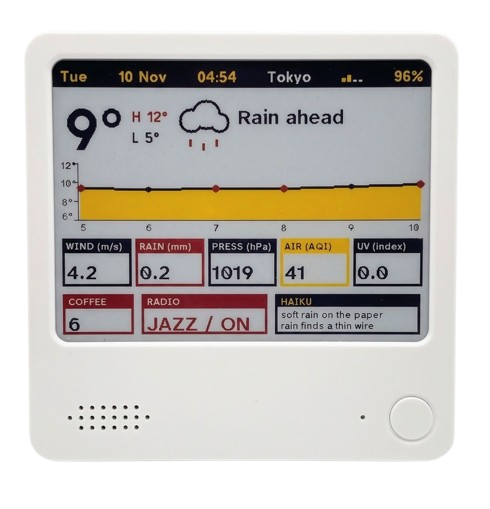

# 🎷JazzTrix

A dashboard with jazz radio, live weather, a brew counter, and a daily haiku. A fully customizable experience, made your own.

<p align="center">
  
</p>

## Requirements

- The [NOTE4](https://www.zectrix.com/en/note4.html) or [NOTE4C](https://www.zectrix.com/en/note4c.html)  
- USB-C cable  
- [Claude](https://claude.com/) or [Cursor](https://cursor.com) to help you flash the firmware

## Setup

Double-tap the round button. The display opens a setup window for about five minutes and shows a pairing code.

1. Join the Wi-Fi network **JazzTrix-Setup**.
2. Open `http://192.168.4.1`.
3. Enter the code from the display.

The page stays on that code until the phone is paired. Then it opens the rest of the settings. A phone that already paired skips the code. From there you can save the home Wi-Fi network, search for a weather place, and change the dashboard.

The home network name and password are stored only in the device’s `home_nvs` partition. They are not in this repository. A full flash backup can contain them.

## Controls

| Control | Action |
| --- | --- |
| Round button, 1 tap | Radio on / off |
| Round button, 2 taps | Open setup |
| Round button, 3 taps | Refresh the screen only |
| Side Up / Down, short | Volume |
| Side Up / Down, hold (~2 s) | Next / previous station |
| Side Up and Down together, hold (~2 s) | Restart the device |
| NFC tap | Count, chime, and refresh the tile |

The paper redraws on its own at most every four hours, and not between 00:00 and 06:00 local time. Coffee, radio, setup, and a triple-tap still refresh.

## Features

Setup stores these choices on the device:

- **Weather place:** searched from the setup page. Nothing is hard-coded.
- **Top bar:** order and visibility for weekday, date, time, place, Wi-Fi, and battery. Each one has a switch. The clock follows the place’s time zone. Date format, 12 or 24 hour time, and the time zone can be changed in setup.
- **Metric tiles:** Wind, Rain, Press, Air, and UV. Each tile can be shown or hidden, and the row can be reordered.
- **Unit suffix:** optional, for example `Wind (m/s)` or `Press (hPa)`.
- **Titles:** box titles are uppercase. The setup page can leave them as written.
- **Wind:** m/s, km/h, or mph. The number changes with the unit.
- **Blocks:** temperature, forecast, NFC counter, and radio. Each can be turned off. The forecast is a graph, with every hour in the window labeled along the bottom. The left side shows at most four temperatures, stepped so they stay apart. Bars are the other choice. It can show 3, 6, 9, or 12 hours ahead.
- **Borders:** on or off around the forecast, the temperature, the sky line (the icon and the condition), the weather tiles, the brew count, the radio, and the haiku. Tiles, brew, radio, and the haiku start with a border. The forecast, the temperature, and the sky line start without one.
- **Bottom row:** the brew count, the radio, and a haiku. Each one can be turned off, and the row can be reordered. The boxes that stay on share the width, so one box fills the row and three keep the usual narrow brew, wider radio, and widest haiku. There are 30. By default the paper shows a new one each local day and keeps it until the next day. The Haiku section can pin one instead. The box is titled Haiku. Each poem is two lines, at most 22 characters, so it stays in English and inside the box. The radio title stays Radio. Its line reads the station name with ON or OFF. A long title or line is cut off at the box.
- **Language:** English, Spanish, Chinese, German, French, Italian, Portuguese, Dutch, and Polish. The page and the paper follow it as soon as you change it. The pairing page is titled Setup, and the page is titled Settings once the phone is paired. The page shows v1.0 at the bottom. The paper shows v1.0 in the pairing bar, next to the word Setup. The version is not on the dashboard.
- **Themes:** Classic, Sunset, Ocean, Marquee, Chorus, Brass, Spotlight, or custom pigments. NOTE4C has four pigments: black, paper, yellow, and red. NOTE4 is black and white; yellow and red are drawn as black. The device recognizes which paper it has. The setup page can force NOTE4 or NOTE4C if that guess is wrong.
- **Dark mode:** swaps paper and black.
- **Radio stations:** from an M3U or PLS list, or from URLs.
- **NFC counter:** the text on the tile.

## Build

JazzTrix builds with [ESP-IDF](https://docs.espressif.com/projects/esp-idf/en/stable/esp32s3/) 6.0 for the ESP32-S3.

```sh
. "$HOME/esp/esp-idf/export.sh"
cd firmware
idf.py set-target esp32s3
idf.py build
```

The application image is `firmware/build/JazzTrix.bin`. Flash that file at `0x20000` only. Leave the bootloader and the partition table on the device as they are.

## License

Version 1.0.

MIT. See [LICENSE](LICENSE). Font notices for the type shipped in the firmware are in `licenses/`.
